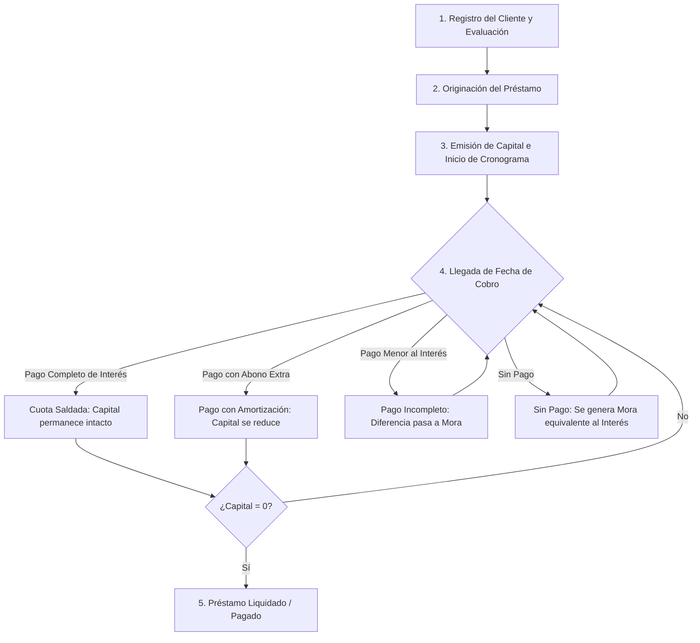

# 📖 Documentación No Técnica y Guía Funcional — PrestaFacilito

Esta guía está diseñada para **operadores, analistas de cobranza, administradores y directivos** que utilizan la plataforma **PrestaFacilito**. Explica el funcionamiento del negocio, las reglas financieras y cómo operar cada módulo sin necesidad de conocimientos de programación.

---

## 🏢 1. Visión y Propósito del Sistema

**PrestaFacilito** es una solución tecnológica diseñada para la micro y pequeña empresa financiera, prestamistas privados e inversionistas de bienes raíces. Permite:
1. **Controlar el capital en circulación** con precisión al céntimo.
2. **Eliminar errores humanos en los cálculos** de cuotas, intereses y moras mediante un motor automatizado.
3. **Clasificar automáticamente los pagos** recibidos de clientes según la prioridad de deuda.
4. **Evaluar el comportamiento crediticio** de cada prestatario para decidir si otorgar futuros préstamos.
5. **Gestionar alquileres de inmuebles** con alertas automáticas de vencimiento y mensualidades.
6. **Centralizar la evidencia fotográfica** (vouchers bancarios, contratos y documentos de identidad) respaldados en la nube.

---

## 👥 2. Roles y Niveles de Acceso

El acceso al sistema se realiza mediante un código **PIN numérico**, protegiendo la confidencialidad de la información según el nivel de responsabilidad:

| Rol | Permisos Principales | Cuándo Usarlo |
| :--- | :--- | :--- |
| **Administrador (`PIN_ADMIN`)** | Control total: Crear, editar y anular préstamos; registrar, corregir y eliminar pagos; aplicar planes de ayuda (congelar intereses); subir y borrar documentos; exportar respaldos Excel; ver reportes BI. | Dueños del negocio, gerentes generales y jefes de operaciones. |
| **Operador (`PIN_OPERATOR`)** | Registro de clientes, creación de préstamos, registro de pagos/abonos diarios, adjuntar vouchers de pago, consultar cronogramas y expedientes. No puede eliminar registros históricos ni alterar configuraciones críticas. | Asistentes de cobranza, cajeros y operadores de campo. |
| **Visualizador (`PIN_VIEWER`)** | Modo solo lectura: Búsqueda de clientes, consulta de saldos pendientes, visualización de cronogramas y galería de vouchers. Sin permisos de modificación. | Auditores externos, contadores o inversionistas consultores. |

---

## 💰 3. Ciclo de Vida de un Préstamo



### 3.1. Tipos de Préstamos Soportados
- **Personal**: Préstamos de libre disponibilidad a sola firma.
- **Con Garantía / Hipotecario**: Préstamos respaldados por inmuebles, terrenos o vehículos, con documentos adjuntos en el expediente.
- **Comercial / Capital de Trabajo**: Para microempresas con frecuencia mensual de pago.

### 3.2. Modelo Francés Adaptativo (Regla de Interés Mensual)
En el modelo de negocio de PrestaFacilito:
- Cada mes se genera un interés sobre el **capital pendiente actual**:
  $$\text{Interés del Mes} = \text{Capital Pendiente} \times \left(\frac{\text{Tasa \%}}{100}\right)$$
- La cuota mínima exigible al cliente es el interés generado en el período más cualquier mora acumulada de meses previos.
- Si el cliente solo paga el interés, el capital se mantiene igual.
- Si el cliente paga un monto superior a la cuota mínima, **el excedente reduce directamente el capital global**, lo cual reduce automáticamente los intereses de todos los meses futuros.

---

## 🔄 4. Cascada de Aplicación de Abonos (Prioridad de Cobro)

Cuando un cliente realiza un depósito o abono de dinero, el sistema distribuye el dinero de forma estricta y transparente siguiendo esta jerarquía:

```
[Monto del Abono Recibido]
         │
         ▼
 1. Cubrir Mora Acumulada Previa (Deudas de meses anteriores)
         │  (Si sobra dinero)
         ▼
 2. Cubrir Interés del Período Actual
         │  (Si sobra dinero)
         ▼
 3. Reducción Directa del Capital Principal (Amortización)
```

### Clasificación Automática de Abonos:
El sistema clasifica el movimiento de acuerdo al monto ingresado:
1. **Liquidación Total**: El monto cancela el 100% del capital y todas las moras pendientes. El préstamo pasa inmediatamente a estado `pagado`.
2. **Pago con Excedente**: El cliente pagó más de la deuda total exigible (se registra el saldo a favor).
3. **Pago con Amortización**: El cliente cubrió la cuota mínima (interés + moras) y abonó dinero extra al capital.
4. **Pago Mínimo**: El cliente cubrió exactamente la cuota mínima del mes (los intereses), manteniendo el capital intacto.
5. **Pago Incompleto**: El cliente pagó una fracción de la cuota mínima. La diferencia restante se convierte en mora para el mes siguiente.
6. **Sin Pago**: El cliente no realizó ningún abono al vencer el período. El interés no cubierto se suma a la mora acumulada.

---

## ⚠️ 5. Gestión de Morosidad y Préstamos Estancados

PrestaFacilito clasifica la salud de la deuda en tiempo real:

- **Al Día**: El cliente ha cancelado todas sus cuotas devengadas o el préstamo está totalmente liquidado.
- **Pendiente Mes**: El período actual está en curso y aún no ha alcanzado la fecha de vencimiento.
- **Mora Mes (1 cuota)**: El cliente tiene 1 cuota vencida sin pagar.
- **Mora Acumulada (2 cuotas)**: El cliente debe 2 cuotas consecutivas.
- **Préstamo Estancado (3 o más cuotas)**: 
  > 🚨 **Alerta Crítica**: Un préstamo pasa automáticamente a categoría **Estancado** cuando acumula **3 o más cuotas impagas**. El sistema lo resalta en color rojo en la cartera y dashboard, requiriendo acción legal o un plan de refinanciamiento/ayuda.

---

## 🤝 6. Plan de Ayuda y Ajustes Financieros

Para recuperar carteras vencidas o brindar facilidades ante emergencias del prestatario, los administradores pueden activar acuerdos especiales:

1. **Congelamiento Temporal de Intereses**:
   - Permite pausar el devengo de intereses entre dos fechas determinadas.
   - En ese período, todo lo que el cliente pague se destina 100% a amortizar el capital.
2. **Condonación / Eliminación de Moras**:
   - Permite anular moras históricas para incentivar al cliente a liquidar el capital restante.
3. **Prórroga de Fecha de Cobro**:
   - Modificación del día de vencimiento mensual para alinearlo a la fecha de pago de sueldo del cliente.

---

## 🏠 7. Módulo de Alquiler de Inmuebles

PrestaFacilito incluye un subsistema especializado para propietarios y administradores de propiedades:

- **Contratos de Alquiler**: Registro de fecha de inicio, fecha de fin (opcional), mensualidad pactada y descripción detallada del predio.
- **Generación de Mensualidades**: El sistema genera el cronograma de renta mes a mes respetando el día fijo de corte (por ejemplo, los días 15 de cada mes).
- **Control de Rentas**: Permite registrar abonos parciales, pagos completos y adjuntar el voucher de la transferencia de alquiler.
- **Alertas de Desalojo / Morosidad**: Identifica inquilinos con más de 3 mensualidades vencidas para inicio de cobranza extrajudicial.

---

## 🏆 8. Score Crediticio del Cliente

Cada cliente posee una calificación calculada automáticamente por el sistema:

| Score | Color | Nivel de Riesgo | Criterio |
| :---: | :---: | :--- | :--- |
| **A** | 🟢 Verde | **Excelente / Confiable** | Puntualidad superior al 70%, sin moras recurrentes, préstamos liquidados a tiempo. Sujeto a ampliación de crédito. |
| **B** | 🟡 Amarillo | **Riesgo Medio / Regular** | Score entre 40% y 69%. Presenta atrasos ocasionales de pocos días pero termina saldando las cuotas. |
| **C** | 🔴 Rojo | **Alto Riesgo / Moroso** | Score menor al 40%. Múltiples cuotas en mora, historial de atrasos severos (>30 días) o préstamos estancados. |

> *Nota:* El Administrador tiene la potestad de sobreescribir manualmente el Score en caso de garantías adicionales o acuerdos comerciales especiales.

---

## 📸 9. Galería de Vouchers y Expedientes Digitales

Para auditoría contable y respaldo legal:
- **Pegado Rápido con `Ctrl+V`**: En cualquier pantalla de registro de cobros, el operador puede copiar una captura de WhatsApp o banca móvil y presionar `Ctrl+V`.
- **Compresión Automática**: Las imágenes se comprimen de forma imperceptible para no sobrecargar el almacenamiento y asegurar que carguen velozmente en conexiones móviles.
- **Sincronización con Google Drive**: Cada comprobante se almacena en la nube de Google Drive de la empresa y se enlaza directamente a la amortización correspondiente.
- **Expediente del Cliente**: Permite subir DNI, copias literales de Registros Públicos, contratos de mutuo y recibos de servicios en la carpeta digital del cliente.

---

## 📊 10. Dashboard Gerencial y Reportes

En la pantalla principal (`/dashboard`) y Business Intelligence (`/bi`), los directivos disponen de:
- **Capital Total en Circulación**: Suma del capital vivo actualmente prestado.
- **Recaudación del Mes**: Total cobrado en soles durante el mes calendario actual versus el mes anterior.
- **Índice de Morosidad**: Porcentaje de la cartera con cuotas vencidas.
- **Gráficos de Tendencia**: Evolución de ingresos de los últimos 6 meses (desglosado entre préstamos y alquileres).
- **Exportación Excel**: Descarga en 1 clic de toda la base de datos (clientes, préstamos, amortizaciones, alquileres) en un archivo `.xlsx` estructurado.
- **Reporte Diario para WhatsApp**: Generación instantánea de una imagen con el resumen de cobranzas del día para enviar a los grupos de trabajo.
