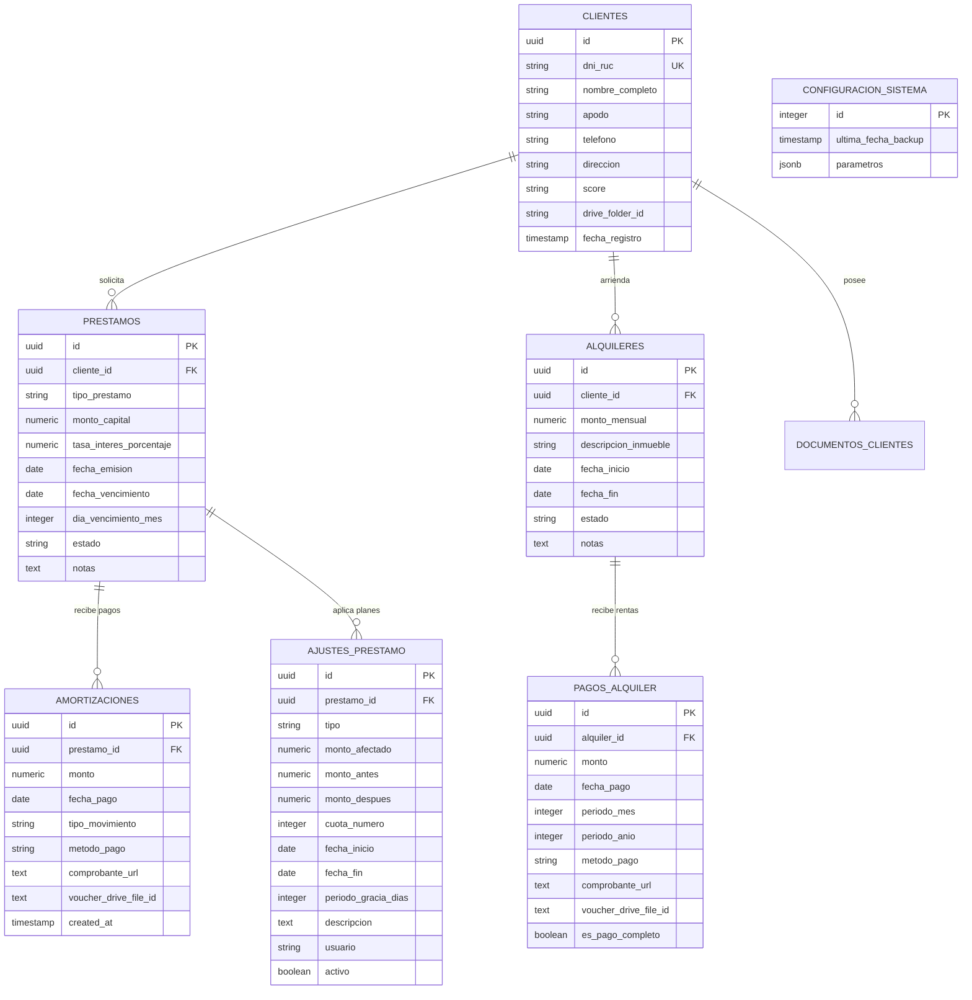

# 🏗️ Documentación Técnica de Arquitectura — PrestaFacilito

Este documento describe la arquitectura de software, el modelo de datos, los flujos de comunicación, la seguridad y las tecnologías utilizadas en la plataforma **PrestaFacilito**.

---

## 📐 1. Diagrama de Arquitectura del Sistema

```mermaid
graph TB
    subgraph "Cliente (Navegador Web)"
        UI["React 19 + TypeScript (SPA)"]
        State["Hooks Custom + Contexts"]
        Canvas["Browser Canvas (Compresión)"]
    end

    subgraph "Servidor de Aplicación (Node.js + Express)"
        Middlewares["Middlewares de Seguridad (CSP, Auth, Error Handler)"]
        Router["Express Router Modular (/api/*)"]
        Engines["Motores Financieros (loanLogic, moraLogic, scoreLogic, alquilerLogic)"]
    end

    subgraph "Capa de Persistencia & Cloud"
        Supabase[("Supabase (PostgreSQL Database)")]
        GoogleDrive["Google Drive API v3 (Vouchers & Docs)"]
        GoogleCalendar["Google Calendar API v3 (Eventos Cobranza)"]
        GeminiAI["Google Gemini AI API (Reportes BI)"]
    end

    UI -->|HTTP / JSON + JWT Cookie| Middlewares
    Middlewares --> Router
    Router --> Engines
    Router -->|Supabase JS Client| Supabase
    Router -->|Google Auth OAuth2| GoogleDrive
    Router -->|Google Auth OAuth2| GoogleCalendar
    Router -->|@google/genai SDK| GeminiAI
    Canvas -->|Base64 optimizado| UI
```

---

## 💻 2. Stack Tecnológico

| Capa / Componente | Tecnología | Versión | Propósito |
| :--- | :--- | :--- | :--- |
| **Frontend Framework** | React | `^19.0.1` | Renderizado declarativo de la interfaz de usuario. |
| **Frontend Routing** | React Router DOM | `^7.15.1` | Navegación SPA basada en rutas declarativas. |
| **Estilos & UI** | Tailwind CSS + Lucide React | `^4.1.14` | Sistema de diseño atómico y set de iconos SVG. |
| **Animaciones UI** | Motion (Framer Motion) | `^12.23.24` | Transiciones fluidas en modales y paneles laterales. |
| **Lenguaje** | TypeScript | `~5.8.2` | Tipado estático en frontend y backend. |
| **Runtime & Servidor** | Node.js + Express | `^4.21.2` | Servidor HTTP REST y middleware de servidor. |
| **Motor de Bundling** | Vite + esbuild | `^6.2.3` | Hot Module Replacement (HMR) en desarrollo y empaquetado CJS en producción. |
| **Base de Datos** | PostgreSQL (Supabase) | `^2.106.1` | Almacenamiento relacional, vistas y consultas indexadas. |
| **Autenticación** | JSON Web Tokens (`jsonwebtoken`) + `cookie-parser` | `^9.0.3` | Sesiones sin estado protegidas mediante cookies HTTP-only. |
| **Integraciones Cloud** | `google-auth-library` | `^10.6.2` | Conexión OAuth 2.0 segura con Google Drive y Google Calendar. |
| **Procesamiento de Archivos** | `xlsx` | `^0.18.5` | Exportación e importación de libros de cálculo Excel. |
| **Inteligencia Artificial** | `@google/genai` | `^1.29.0` | Generación de resúmenes ejecutivos y análisis de morosidad. |

---

## 🗄️ 3. Modelo de Datos Relacional (PostgreSQL en Supabase)

### 3.1. Esquema de Tablas Principales



---

## 🔐 4. Arquitectura de Seguridad y Autenticación

### 4.1. Flujo de Autenticación por PIN
1. El usuario ingresa su PIN numérico en `/login`.
2. El endpoint `POST /api/auth/login` compara el PIN contra las variables de entorno (`PIN_ADMIN`, `PIN_OPERATOR`, `PIN_VIEWER`).
3. Si es válido, se firma un JWT con `HS256` que contiene:
   ```json
   {
     "role": "admin",
     "username": "Administrador",
     "iat": 1740480000,
     "exp": 1740566400
   }
   ```
4. El servidor emite una cookie HTTP `token`:
   - `HttpOnly: true` (inaccesible desde JavaScript en el navegador, protege contra XSS).
   - `SameSite: Strict` (protección contra CSRF).
   - `Secure: true` (en entorno de producción).
5. En cada petición posterior a `/api/*`, el middleware `requireAuth` valida la firma del token (ya sea desde la cookie o desde la cabecera `Authorization: Bearer <token>`).

### 4.2. Cabeceras de Seguridad (CSP & Headers)
El servidor inyecta en todas las respuestas HTTP cabeceras estrictas:
- **`Content-Security-Policy`**: Restringe orígenes de scripts, estilos, fuentes (`Google Fonts`), conexiones (`Supabase`, `Google APIs`) y frames.
- **`X-Frame-Options: DENY`**: Evita ataques de Clickjacking.
- **`X-Content-Type-Options: nosniff`**: Previene ataques de MIME sniffing.
- **`Referrer-Policy: no-referrer`**: Previene fuga de URLs sensibles en cabeceras HTTP.
- **`Cache-Control: no-store, no-cache`**: Evita que proxies intermedios almacenen datos financieros confidenciales.

---

## ☁️ 5. Integraciones con Servicios Externos

### 5.1. Google Drive API v3 (Almacenamiento de Archivos)
- **Autenticación**: `OAuth2Client` de `google-auth-library` con `GOOGLE_REFRESH_TOKEN`.
- **Subida de Archivos**: Peticiones `multipart/related` que envían metadatos (nombre, carpeta contenedora) y buffer binario en un solo request.
- **Proxy Seguro (`/api/vouchers/proxy/:fileId`)**: Las imágenes no se exponen con enlaces públicos de Drive; el backend actúa como proxy autenticado que descarga el stream desde Google Drive y lo entrega al navegador con cabecera `Cache-Control: public, max-age=86400`.
- **Carpetas por Cliente**: Creación automática de subcarpetas `Documentos - [Nombre Cliente]` en Drive para organizar DNI y garantías.

### 5.2. Google Calendar API v3 (Cronograma de Cobranzas)
- Sincronización bidireccional de eventos en Google Calendar:
  - Título: `Cobro S/ [Monto] - [Nombre Cliente]`
  - Descripción: Detalle de cuota, tasa y estado del préstamo.
  - Actualización automática al editar o eliminar pagos.

### 5.3. Google Gemini AI API (`@google/genai`)
- Modelo: `gemini-2.5-flash`
- Procesa el resumen de deuda global y genera un diagnóstico financiero con recomendaciones ejecutivas sobre clientes de alto riesgo y estrategias de recuperación de capital.

---

## 📦 6. Pipeline de Compilación y Ejecución

```
Desarrollo:
  tsx server.ts (Express + Vite Dev Server en modo Middleware con HMR)

Producción:
  1. vite build                       -> Genera assets estáticos SPA en dist/
  2. esbuild server.ts --bundle        -> Compila backend Node.js en dist/server.cjs
  3. node dist/server.cjs              -> Servidor productivo sirviendo API y frontend SPA
```
