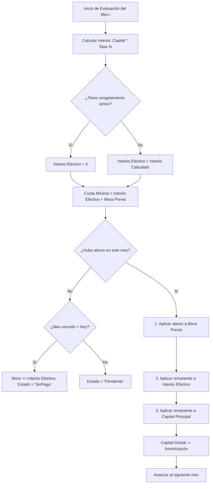

# ⚙️ Módulo Interno: Motor de Cálculo Financiero y Amortización (`loanLogic.ts`)

- **Ubicación del Código Fuente**: [`src/lib/loanLogic.ts`](file:///home/sjaquer/Downloads/prestafacilito/src/lib/loanLogic.ts)
- **Pruebas Automatizadas**: [`src/lib/__tests__/loanLogic.test.ts`](file:///home/sjaquer/Downloads/prestafacilito/src/lib/__tests__/loanLogic.test.ts)
- **Propósito**: Ejecutar el cálculo dinámico del cronograma de pagos, devengo de intereses, cascada de abonos, moras, saldo exigible y clasificación automática de pagos bajo el modelo financiero adaptativo de PrestaFacilito.

---

## 📋 1. Funciones Principales y Firmas TypeScript

### 1.1. `buildPaymentSchedule(prestamo, pagos, options): EstadoDeudaPrestamo`
Construye el cronograma mes a mes proyectado desde la fecha de emisión hasta la fecha actual o el último pago registrado.

```typescript
export interface BuildScheduleOptions {
  ajustes?: AjustePrestamo[];
  referenceDate?: Date;
}

export const buildPaymentSchedule = (
  prestamo: Prestamo,
  pagos: Amortizacion[] = [],
  options: BuildScheduleOptions = {}
): EstadoDeudaPrestamo;
```

#### Parámetros:
- `prestamo` (`Prestamo`): Objeto con datos del préstamo (`monto_capital`, `tasa_interes_porcentaje`, `fecha_emision`, `estado`).
- `pagos` (`Amortizacion[]`): Array de pagos/abonos realizados por el cliente.
- `options` (`BuildScheduleOptions`):
  - `ajustes`: Planes de ayuda o acuerdos especiales (congelamiento de interés).
  - `referenceDate`: Fecha de corte para simular cálculos históricos o proyecciones.

#### Retorno (`EstadoDeudaPrestamo`):
- `resumen`: Objeto con `capitalPendiente`, `interesPendiente`, `moraAcumulada`, `totalExigible`, `totalPagado`, `saldoPendiente`, `esEstancado`, `cuotasVencidas`.
- `cuotas`: Array de `CuotaPrestamo` con el desglose mensual (cuota base, abono aplicado a mora/interés/capital, días de atraso, estado).
- `cuotaSiguiente`: Próxima cuota exigible no saldada.
- `cuotasVencidasDetalle`: Array filtrado de cuotas en mora o sin pago.
- `planAyuda`: Beneficios acumulados y estado de congelamiento.

---

### 1.2. `classifyPayment(paymentAmount, debtState, paymentDateStr): string`
Clasifica de forma semántica el tipo de movimiento de un abono recibido.

```typescript
export const classifyPayment = (
  paymentAmount: number,
  debtState: EstadoDeudaPrestamo,
  paymentDateStr?: string
): "Pago inválido" | "Liquidación total" | "Pago con excedente" | "Pago mínimo" | "Pago con amortización" | "Pago incompleto" | "Amortización a capital";
```

#### Reglas de Clasificación:
1. `amount <= 0` $\rightarrow$ `"Pago inválido"`
2. `amount >= totalExigible - 0.01` $\rightarrow$ `"Liquidación total"` (o `"Pago con excedente"` si `amount > totalExigible + 0.01`).
3. `amount < cuotaMinima - 0.01` $\rightarrow$ `"Pago incompleto"`.
4. `|amount - cuotaMinima| <= 0.01` $\rightarrow$ `"Pago mínimo"`.
5. `amount > cuotaMinima` $\rightarrow$ `"Pago con amortización"`.

---

### 1.3. Funciones Utilitarias Auxiliares

```typescript
// Redondeo financiero estricto a 2 decimales evitando errores de punto flotante
export const round2 = (n: number): number => Math.round((n + Number.EPSILON) * 100) / 100;

// Conversión segura de valores desconocidos a números finitos
export const toNumber = (value: unknown): number;

// Normalización de fechas a hora local 00:00:00
export const normalizeDate = (dateValue: string | Date): Date;

// Suma de meses preservando el día límite del mes (ej: 31 de enero + 1 mes = 28/29 de febrero)
export const addMonthsClamped = (dateValue: string | Date, months: number): Date;
```

---

## 🔀 2. Algoritmo de Cascada de Pagos en Cada Mes



---

## 🧪 3. Casos de Prueba Clave

| Escenario | Entrada | Resultado Esperado |
| :--- | :--- | :--- |
| **Préstamo Nuevo sin Pagos** | Capital: S/ 10,000, Tasa: 10%, 1 mes vencido | Capital: S/ 10,000, Mora: S/ 1,000, Total Exigible: S/ 11,000, Estado cuota: `SinPago`. |
| **Pago Mínimo de Interés** | Capital: S/ 10,000, Abono: S/ 1,000 | Capital: S/ 10,000 (intacto), Interés pagado: S/ 1,000, Mora: S/ 0, Estado: `Saldada`. |
| **Abono con Amortización Extra** | Capital: S/ 10,000, Abono: S/ 3,000 | Interés pagado: S/ 1,000, Capital amortizado: S/ 2,000, Nuevo Capital: S/ 8,000. |
| **Pago Incompleto** | Capital: S/ 10,000, Abono: S/ 600 | Interés cubierto: S/ 600, Mora generada para el próximo mes: S/ 400, Estado: `PagoIncompleto`. |
| **Liquidación Total Anticipada** | Capital: S/ 5,000 + Mora: S/ 500, Abono: S/ 5,500 | Capital: S/ 0, Mora: S/ 0, Total Exigible: S/ 0, Préstamo pasa a `pagado`. |
