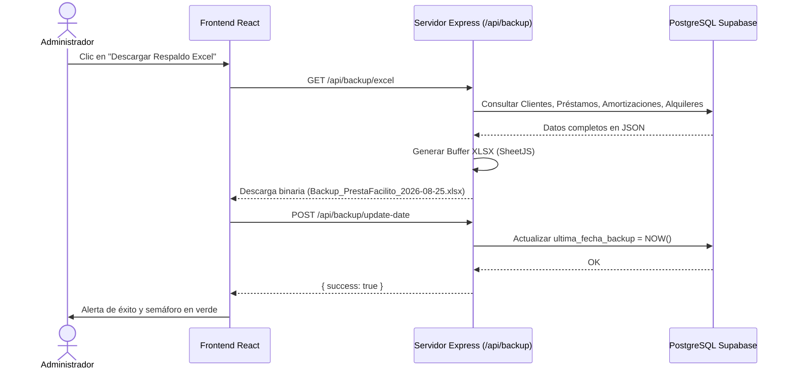

# ⚙️ Módulo Interno: Motor de Respaldos y Exportación Excel (`backup.routes.ts`)

- **Ubicación del Código Fuente**: [`routes/backup.routes.ts`](file:///home/sjaquer/Downloads/prestafacilito/routes/backup.routes.ts)
- **Librería Utilizada**: `xlsx` (SheetJS)
- **Propósito**: Proporcionar un mecanismo de respaldo integral de la base de datos en formato de libro de cálculo de Microsoft Excel (`.xlsx`), controlando la cadencia de respaldos para alertar a la gerencia si han transcurrido más de 7 días sin una copia de seguridad local.

---

## 📊 1. Estructura del Libro de Respaldo Excel

El endpoint `GET /api/backup/excel` extrae toda la base de datos relacional y genera un archivo `.xlsx` con **5 hojas independientes**:

```
Backup_PrestaFacilito_YYYY-MM-DD.xlsx
├── 📄 Clientes            (ID, DNI/RUC, Nombre, Teléfono, Dirección, Score, Registro)
├── 📄 Préstamos           (ID, ID Cliente, Tipo, Capital, Tasa %, Día Cobro, Emisión, Vencimiento, Estado, Notas)
├── 📄 Amortizaciones       (ID, ID Préstamo, Monto, Fecha Pago, Tipo Movimiento, Método, Comprobante URL, Drive File ID)
├── 📄 Alquileres          (ID, ID Inquilino, Mensualidad, Inmueble, Fecha Inicio, Fecha Fin, Estado, Notas)
└── 📄 Pagos Alquiler      (ID, ID Alquiler, Monto, Fecha Pago, Mes, Año, Método, Comprobante URL, Drive File ID)
```

---

## ⏰ 2. Control de Periodicidad y Alertas (`GET /api/backup/status`)

- Consulta la tabla `configuracion_sistema` (registro `id: 1`).
- Calcula los días transcurridos desde `ultima_fecha_backup`.
- Si `dias_transcurridos >= 7` $\rightarrow$ `requiere_backup = true`.
- El frontend muestra una alerta visual amarilla/roja en la barra superior del sistema recordando descargar el respaldo semanal.

---

## 📥 3. Flujo de Descarga y Actualización


